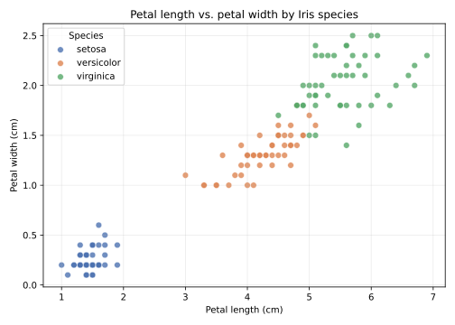
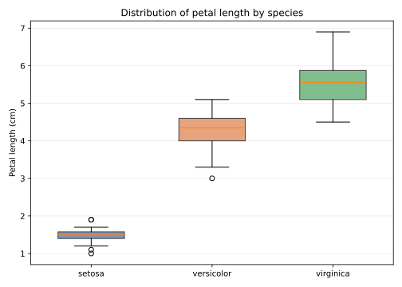

# Iris Morphology: How Well Do Petal Measurements Separate Species?

A small, reproducible exploratory data analysis of the classic Iris dataset. The
project asks whether simple petal measurements are enough to tell the three Iris
species apart, and which measurements carry the most signal.

## Research question

**How well do petal length and petal width separate *Iris setosa*,
*Iris versicolor*, and *Iris virginica*, and which measurements are most
discriminative?**

## Dataset and usage permissions

- **Dataset:** Iris dataset (R. A. Fisher, 1936), 150 samples, 4 numeric
  features, 3 balanced species classes.
- **Source:** Distributed with scikit-learn via `sklearn.datasets.load_iris`,
  originally published in the UCI Machine Learning Repository.
- **Permissions:** The Iris dataset is in the public domain and is widely used
  for teaching and method demonstration. No personal, confidential, or
  restricted data is used. The repository contains no credentials or API keys.

## Methods and tools

- **Python 3** with `pandas` for tabular summaries and `scikit-learn` for
  loading the data and cross-validation.
- **matplotlib** for the two figures.
- **Descriptive analysis:** per-species mean and standard deviation for all four
  measurements, plus the Pearson correlation between petal length and petal
  width.
- **Simple model check:** a depth-3 decision tree trained on petal length and
  petal width only, evaluated with stratified 5-fold cross-validation to
  quantify how separable the species are.

## Key findings

- *Iris setosa* is completely separated from the other two species on petal
  measurements: its petals are short and narrow (mean petal length ≈ 1.46 cm).
- *Iris versicolor* and *Iris virginica* are mostly separable, with a small
  overlap around petal lengths of 4.5–5.0 cm.
- Petal length and petal width are strongly positively correlated
  (r ≈ 0.96), and a decision tree using only these two features reaches about
  96% cross-validated accuracy.
- Petal measurements are therefore far more discriminative than sepal
  measurements for this dataset.

**Limitation:** the dataset is small, balanced, and historical (150 flowers
from one original collection), so the near-perfect separation should not be
assumed to hold for other populations, measurement protocols, or real-world
classification tasks without external validation.

## Figures



*Figure 1. Petal length vs. petal width, coloured by species. Setosa forms an
isolated cluster; versicolor and virginica nearly separate along a diagonal
boundary.*



*Figure 2. Distribution of petal length by species. The boxes show the
interquartile range, the whiskers extend to 1.5× IQR, and the line marks the
median.*

## Project structure

```
data-science-project/
├── analysis.py              # full, reproducible analysis
├── requirements.txt         # Python dependencies
├── figures/
│   ├── petal_scatter.svg
│   └── petal_box.svg
├── results/
│   └── species_summary.csv  # generated summary table
└── README.md
```

## How to run

```bash
# 1. Clone the repository
git clone https://github.com/liuhaixiang-um/data-science-project.git
cd data-science-project

# 2. Create and activate a virtual environment (optional but recommended)
python3 -m venv .venv
source .venv/bin/activate        # Windows: .venv\Scripts\activate

# 3. Install dependencies
pip install -r requirements.txt

# 4. Run the analysis
python analysis.py
```

The script writes `figures/petal_scatter.svg`, `figures/petal_box.svg`, and
`results/species_summary.csv`, and prints the summary statistics, correlation,
and cross-validation accuracy to the terminal.

## Status

Completed as part of the CISC7204 Practice 09 learning activity.
